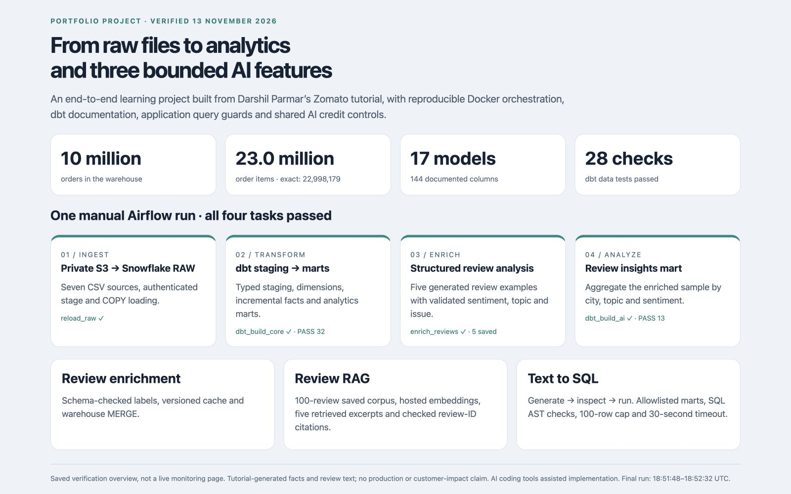
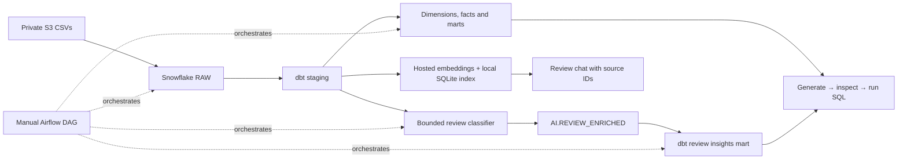
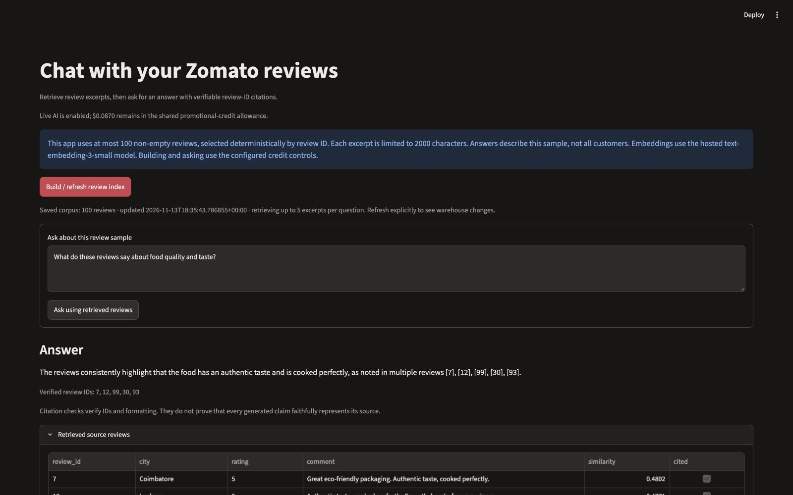

# Zomato AI Data Pipeline

A tutorial-derived data engineering project that loads private S3 CSV files into Snowflake, builds a tested dbt warehouse, orchestrates a manual Airflow workflow in Docker, and demonstrates three bounded AI features.



The verified warehouse contains **10,000,000 orders** and **22,998,179 order items**. The final four-task Airflow run passed on November 13, 2026, with **17 dbt models and 28 passing data tests** across the core and AI builds. These are tutorial-data counts and one successful replay, not production traffic or ingestion throughput.

## What it does

| Layer | Implemented behavior |
|---|---|
| Ingestion | Seven CSV sources in a private S3 bucket, IAM storage integration, Snowflake external stage and `COPY INTO` loading. |
| Transformation | Seven staging views, four dimensions, two incremental facts and four analytical marts. |
| Quality and documentation | 28 dbt data tests, lineage, descriptions for all 17 models and 144 output columns. |
| Orchestration | A manual, four-task Airflow DAG, separate Python environments, encrypted service-user key authentication and persistent local metadata. |
| Review enrichment | Structured sentiment, score, topic and key issue; response validation, versioned cache and warehouse `MERGE`. Five generated-review examples were saved in the final run. |
| Review RAG | Hosted embeddings over a 100-review saved corpus; retrieve up to five excerpts, answer with checked review-ID citations, or report insufficient evidence. |
| Natural language SQL | Inspect the available mart schema, generate SQL, review it, then run separately. AST checks, relation/function allowlists, a 100-row result cap and a 30-second timeout. |



## Verified examples

- **Enrichment:** review 1 was classified positive / packaging / +0.9; review 2 negative / pricing / −0.7 with an issue phrase; review 3 neutral / other / 0.0.
- **Review RAG:** food-quality answers cited reviews 7, 12, 99, 30 and 93; a price/value complaint cited review 78. A company-profit question returned insufficient evidence.
- **Warehouse SQL:** delivered GMV by city, delivered-order average duration by city and cancellation rate by payment method. The generated queries were inspected before execution.

See the [example gallery](portfolio/README.md), [feature details](docs/FEATURES.md), [case study](docs/CASE_STUDY.md) and [verification record](docs/VERIFICATION.md). The gallery includes full 1600 × 1000 screenshots of the final workflow, the apps, dbt lineage and saved warehouse outputs. Rendered evidence pages are explicitly identified separately from live application screenshots.



## Reproduce it

Start with [setup](docs/SETUP.md), [data provenance and file layout](docs/DATA.md), and [manual testing](FINAL_TESTING.md). Cloud data, credentials, private keys and armed credit state are not included.

For the offline AI checks, with a suitable Python environment and the dependencies in the setup guide:

```bash
python -m unittest discover -s tests/ai -v
```

The public export passed **77 offline tests**: the working project's 71 tests plus six configuration-portability checks. These use fake external boundaries; they make no model or warehouse calls. The public copy externalizes account identifiers and promotional expiry; missing expiry leaves live AI locked.

The shared image isolates Airflow, dbt and AI dependencies. The portable Docker wrapper respects your existing Docker context. Opening an app does not automatically call a model or start the pipeline.

## Cost controls and practical limits

This project was demonstrated using existing trial/promotional credits without a new purchase, upgrade or local model download. Reproducing hosted S3, Snowflake or OpenAI usage is not universally free. Verify your own account conditions first. There is no public deployment running from this repository.

AI requests share a persistent **$0.10 conservative reservation cap** and require an explicit, unexpired credit confirmation. Failures retain reservations; there is no automatic retry, provider substitution or paid fallback. This local allowance does not replace provider billing controls or monitor unrelated account activity. The configured tutorial chat model is `gpt-4o-mini`; availability must be checked before a future live run.

The SQL app applies validation using the tutorial's existing broad role; it does not provide a database-enforced read-only account or prove that a generated metric is correct. Review the SQL, grain and filters before execution. RAG citation checks validate IDs and formatting, not semantic accuracy. Its small deterministic corpus and the five enrichment examples do not establish model accuracy or population sentiment. Incremental facts use timestamp high-water filters and do not recover older late-arriving changes automatically.

After a demonstration, follow [shutdown and retained-resource notes](docs/SHUTDOWN.md). Stopping containers and suspending a warehouse does not delete cloud storage.

## Source and authorship

Guided implementation by Vansh Verma, developed with AI coding assistance, based on [Darshil Parmar's Zomato end-to-end tutorial](https://www.youtube.com/watch?v=kYwaNMQ3XT8) and [pinned source revision](https://github.com/darshilparmar/zomato-ai-data-engineering-end-to-end-project/tree/57d147dfe6aaed6bfe7c215d74185c39358790a4). Orders, order items and review texts are tutorial-generated data. No independent production deployment or business-impact claim is made.

See [NOTICE](NOTICE) for attribution and the unresolved upstream license status. No license grant is invented here; dataset and upstream reuse terms should be checked before further redistribution.
