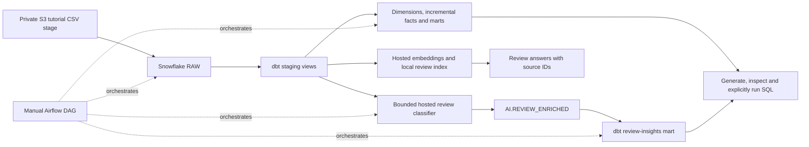

# Restaurant orders, batch orchestration and bounded AI analysis

This tutorial-adapted project turns recorded restaurant orders and reviews into a Snowflake warehouse, runs the transformations through a manually triggered Airflow DAG, and adds three bounded AI capabilities: review classification, retrieval-augmented review answers and natural language to SQL.

Vansh Verma owns this guided implementation, which was developed with AI coding assistance. The architecture and learning sequence credit [Darshil Parmar's tutorial](https://www.youtube.com/watch?v=kYwaNMQ3XT8) and its [pinned source revision](https://github.com/darshilparmar/zomato-ai-data-engineering-end-to-end-project/tree/57d147dfe6aaed6bfe7c215d74185c39358790a4). This project uses the creator's tutorial data and domain; Olist is a separate, unimplemented follow-on project.

## Problem and resulting behavior

The warehouse separates source cleanup, dimensions, order facts and analytical summaries. It answers questions about recorded delivered sales, cancellation ratios, restaurant summaries and delivery-duration distributions. The AI features inspect a small review subset or propose a query over explicitly permitted marts.

The verified release warehouse contains 10,000,000 order facts and 22,998,179 order-item facts. These are tutorial-data counts, not production traffic, new rows ingested in the latest replay or a throughput benchmark.

The manually triggered final workflow is:

```text
COPY seven existing S3 sources
  → build/test core dbt models
  → classify a bounded review sample
  → build/test the AI review-insights mart
```

The two interactive applications run separately. Review chat retrieves saved review evidence before asking for a cited answer. Warehouse chat generates SQL, shows it to the user and executes it only after a separate Run query action.

## Architecture



The Mac runs the Docker/Colima services and small Streamlit interfaces. Snowflake, S3 and inference are hosted services. Airflow metadata uses a separate local Postgres database. Airflow, dbt and the AI code have separate Python environments inside the container image, preventing their connector/dependency requirements from being mixed.

## Modeling decisions that affect interpretation

| Relation or metric | Grain and meaning |
|---|---|
| `fct_orders` | One intended `order_id`; recorded order attributes and amounts. |
| `fact_order_items` | One intended `order_item_id`, inner-joined to a matching order header. |
| `mart_daily_city_revenune` | One order date/restaurant-city group. Counts all orders and separately sums delivered sales. The tutorial filename spelling is preserved. |
| GMV and AOV | Recorded sales amounts for delivered orders and their per-delivered-order average; neither establishes settlement, profit or accounting revenue. |
| Cancellation ratio | Cancelled-order count divided by all order rows in the date/city group, using the tutorial's `COUNT_IF`/`DIV0` expression. |
| `mart_delivery_sla` | One restaurant-city/order-hour group among delivered orders; median and 90th-percentile recorded duration. It does not calculate a late-delivery or promised-time compliance rate. |
| `mart_restaurant_performance` | Restaurant key plus joined dimension attributes. Rating and duration averages use all non-null source values across statuses; delivered sales are summed separately. |
| `mart_review_insights` | One restaurant-city/topic/sentiment group within the accumulating enriched subset. It does not estimate population sentiment. |

The SQL's existing NULL and zero behavior is retained. Model and column descriptions document transformations, exclusions and these limits for all 17 models and 144 output columns.

Both incremental facts use a strict timestamp high-water filter. This supports the tutorial's append-oriented replay, but updates or late records with an older/equal timestamp are not recovered by that policy. Source deletions and historical change capture are not implemented.

## Engineering and AI controls

- The final manual run `release_final_20261113T185136Z` completed all four tasks successfully on attempt 1. It replayed the existing sources, built/tested the core warehouse, selected and saved five review classifications, then built/tested the AI mart.
- The live core build reported 16 model successes and 16 passing tests. The AI build reported one model success and 12 passing tests: 17 models and 28 data tests across the two builds. The separate offline suite passed 71 tests with fake external boundaries.
- Review classifications are validated against a fixed schema and taxonomy. Successful responses are cached before warehouse persistence; a `MERGE` retains the latest classification for each review ID. This is a local bounded workflow rather than a distributed exactly-once guarantee.
- Review RAG uses a deterministic small corpus, hosted embeddings and a local SQLite cache. Citation checks require real retrieved IDs and matching inline references; they do not prove that every generated statement faithfully represents its excerpt.
- SQL generation uses actual whitelisted mart metadata, a Snowflake AST validator and column resolution before approval. Execution is a separate action, limited to 100 returned rows and a 30-second query timeout. The existing broad tutorial role is unchanged; this is application validation, not a dedicated database-enforced read-only role.
- Hosted requests require an unexpired, explicitly confirmed promotional-credit allowance. The ledger caps conservative reservations at $0.10 and has no automatic paid fallback. It does not monitor unrelated account use or replace account-level billing controls.

See [feature behavior and model inventory](FEATURES.md) and the [manual testing guide](../FINAL_TESTING.md) for the corresponding workflows.

## Verification register

This register distinguishes code/configuration checks from accepted live demonstrations. Private working-copy evidence is retained separately from the public narrative.

| Evidence | Current recorded state | Private working-copy location |
|---|---|---|
| Final four-task AI DAG | Verified success on November 13, 2026; all four tasks succeeded on attempt 1 in `release_final_20261113T185136Z`. | `verification/2026-11-13-release/final_run.json` and `final_tasks.json` |
| Live dbt results and bounded enrichment | Core PASS=32, AI PASS=13; five reviews selected and five saved. | `verification/2026-11-13-release/dbt_build_core_logs.json`, `enrich_reviews_logs.json` and `dbt_build_ai_logs.json` |
| Final warehouse examples/counts | Retained 10,000,000 order facts and 22,998,179 item facts; five stored classifications and five grouped review-insight rows. | `verification/2026-11-13-release/warehouse_examples.json` |
| Offline behavioral checks | 71 tests passed using fake external boundaries. | `verification/2026-11-13-release/offline_tests_final.log` |
| Model-description qualification | Offline dbt parse passed: 17 models, 144 documented output columns, 28 tests and 8 sources. SQL output names independently matched the metadata; SQL and test configuration remained unchanged. | `verification/2026-11-13-release/dbt-description-check/metadata_receipt.json` |
| Review RAG live examples | Release owner inspected a food-quality answer with review IDs 7, 12, 99, 30 and 93; a price/value answer cited 78; a profitability question returned insufficient evidence. These are bounded examples, not an accuracy score. | [RAG examples](../portfolio/evidence/rag_examples.json) |
| Natural language SQL live example | The delivered-GMV question completed the separate Generate/Run flow and returned results. No numeric answer or general accuracy rate is asserted here. | [SQL gallery](../portfolio/README.md) |
| Final screenshots | Captured at 1600 × 1000 with individual evidence captions; see [gallery](../portfolio/README.md). | [Screenshot manifest](../portfolio/screenshots/manifest.json) |

## Limits and next learning work

The project demonstrates the recorded tutorial workflow with explicit local and hosted components. The final run reuses the previously loaded warehouse; its elapsed time is not a fresh-load benchmark. Successful demonstrations are evidence of those runs, not production reliability, a general SQL security guarantee or measured model accuracy.

Review labels remain model interpretations. Retrieval similarity is a ranking value rather than confidence, and the small corpus does not measure customer-wide prevalence or explain causal effects. Independent evaluations and larger operational qualification would require separate work.

The reproducibility instructions depend on admitted tutorial data, private service configuration and usable service credits. Those private inputs are kept outside the source package. Vansh's independent explanations and modifications are learning checkpoints separate from generated code and passing jobs.
