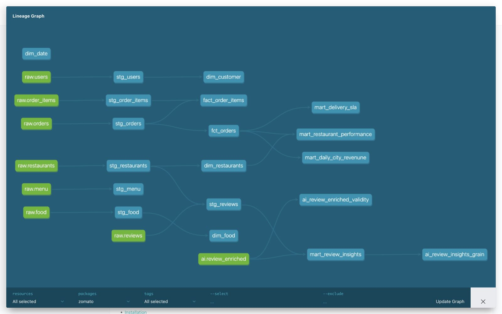
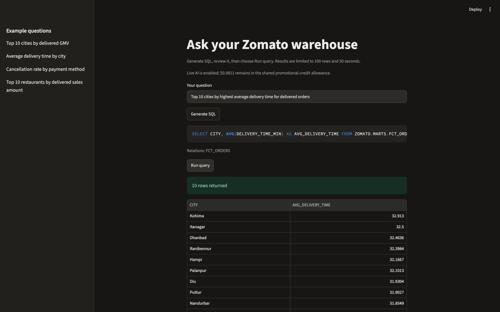
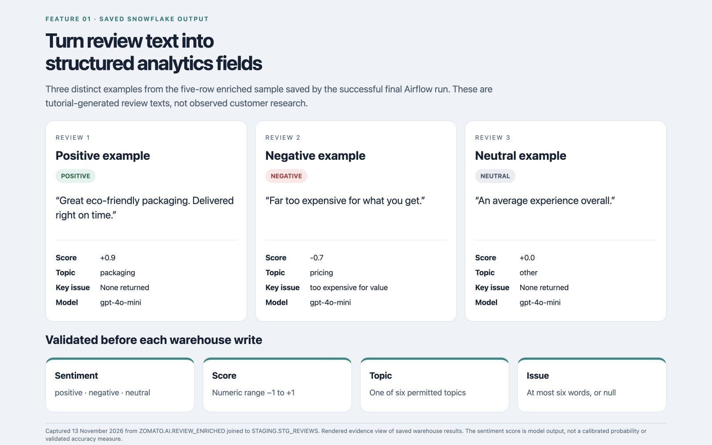
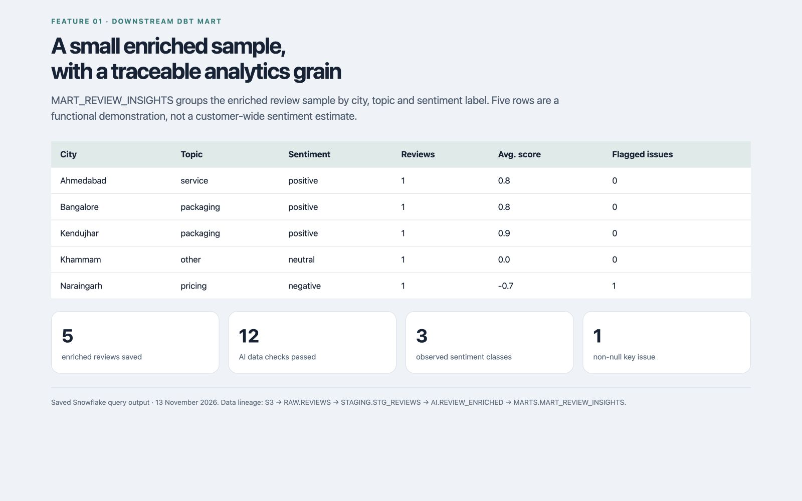
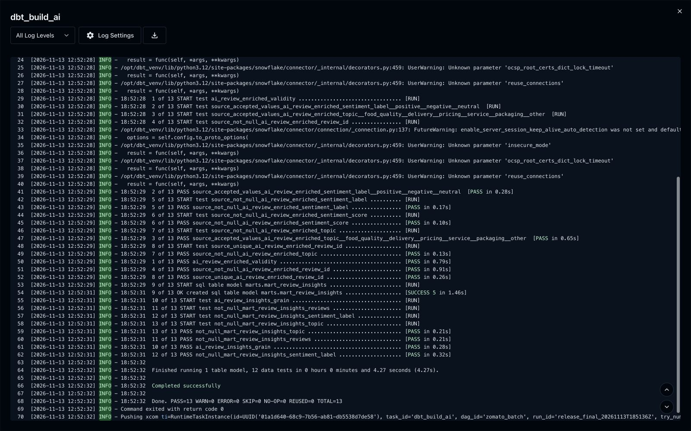
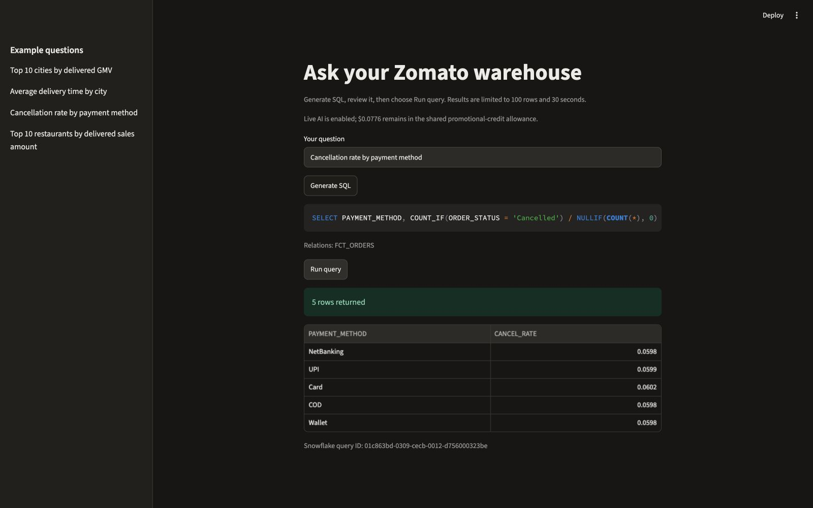

# Final project screenshot and example gallery

All 15 release captures are 1600 × 1000 JPEGs from November 13, 2026. The [manifest](screenshots/manifest.json) includes individual captions and file hashes. The private working folder also retains seven earlier Phase 1 captures; they are historical and are not mixed into this release gallery.

Start with the overview, final Airflow run, full dbt lineage, enrichment examples, RAG answer and SQL result for a six-image walkthrough. Use the individual feature sequences for a longer case study or carousel. No social post was published by this release.

These are fixed-viewport captures. Some SQL panes scroll horizontally and some result/source tables continue below the image edge. The [complete accepted SQL records](evidence/sql_examples.json) preserve the generated statements; each image caption states its evidence scope. The final saved-result chart is a rendered data artifact rather than a live app screen.

## SQL: delivered GMV by city

Live Streamlit generation, reviewed SQL and ten Snowflake results. GMV is recorded delivered sales amount, not profit.

## RAG: food-quality question

Live app answer with five retrieved source excerpts and matching inline review-ID citations.

## RAG: price/value complaint

Live app answer cites review 78; retrieved positive value comments remain visible for comparison.

## RAG: insufficient evidence

Live app declines a company-profit question that the review excerpts cannot answer.

## dbt: full release lineage

Generated dbt documentation after the successful final run, including the AI source, mart and tests.

## SQL: delivered-order duration

Live reviewed query computes order-grain AVG for delivered orders; ten highest-average cities returned. Captured before the later independent column-resolution guard.

## dbt: AI mart catalog

Generated catalog shows the five-row AI mart, its documented grain, limits and output columns.

## Airflow: four-task run passed

All four tasks green, final run success, manual trigger, first attempts. 44 seconds is an existing-data replay, not a fresh-load benchmark.

## Project overview

Rendered summary of saved verification facts, explicitly labeled as a portfolio evidence view rather than a live dashboard.

## Enrichment: positive, negative and neutral

Rendered saved Snowflake outputs for three generated review texts. Labels and scores came from the successful final enrichment task.

## Enrichment: downstream review mart

Rendered saved Snowflake rows grouped by city/topic/sentiment; five reviews demonstrate the workflow only.

## Airflow: AI build/test log

Live Airflow log viewer shows 1 model, 12 passing data tests, PASS=13 and exit code 0.

## dbt: order-fact catalog

Generated catalog for the 10 million-row order fact with authored descriptions and incremental-model context.

## SQL: cancellation by payment method

Live generation and execution after the final schema-resolution guard. Numerator counts Cancelled orders; denominator includes all orders. Five methods returned.

## SQL: saved GMV result chart

Rendered Matplotlib chart of the ten values retained from the accepted live GMV query. This is a saved-results visualization, not a live application screenshot; no new model call or warehouse query was used.

## Supporting data

- [Release summary](evidence/release_summary.json)
- [Saved warehouse examples and counts](evidence/warehouse_examples.json)
- [Accepted RAG examples](evidence/rag_examples.json)
- [Accepted SQL examples](evidence/sql_examples.json)
- [Core dbt summary](evidence/dbt_build_core_summary.txt)
- [AI dbt summary](evidence/dbt_build_ai_summary.txt)

The overview and enrichment cards are rendered evidence pages generated by `build_showcase.py` from retained warehouse outputs. The Airflow, dbt and Streamlit screenshots show their actual interfaces. Tutorial-generated facts/review texts do not establish production traffic, real-customer research or model accuracy.

The standalone [SVG](showcase/gmv-delivered-cities.svg) and [PNG](showcase/gmv-delivered-cities.png) are included for sharing. To regenerate the optional chart artifact, install the pinned plotting dependency from `requirements-portfolio.txt` in a separate environment and run `python portfolio/build_chart.py` from the repository root. This step reads the saved public-safe JSON and makes no model or warehouse request.
