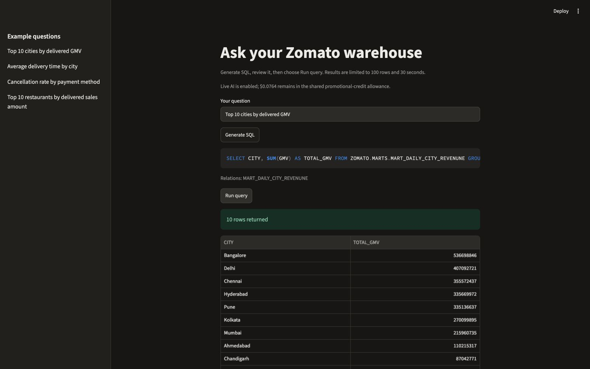
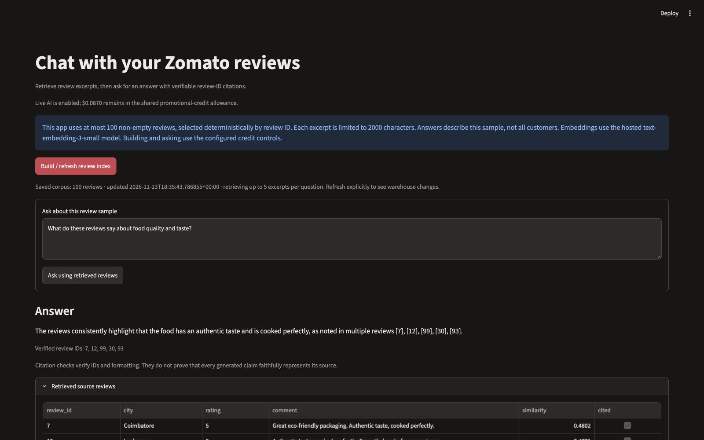
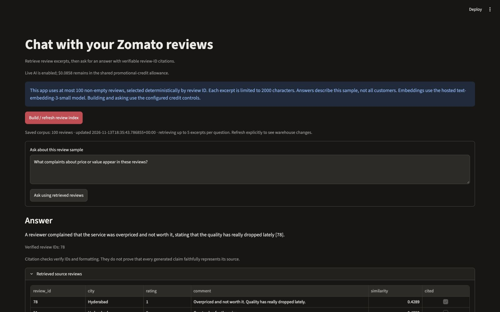
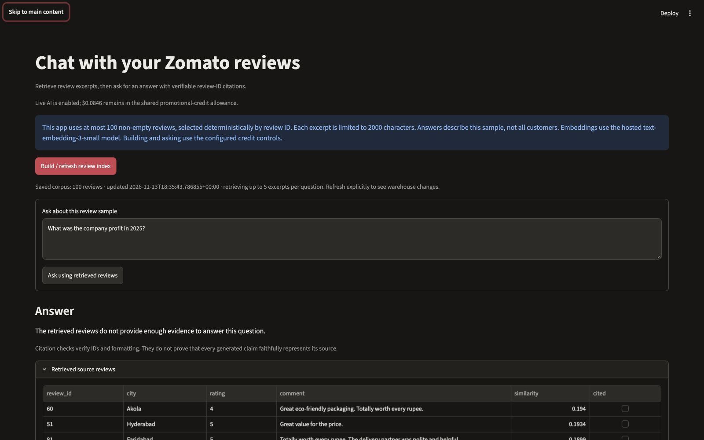
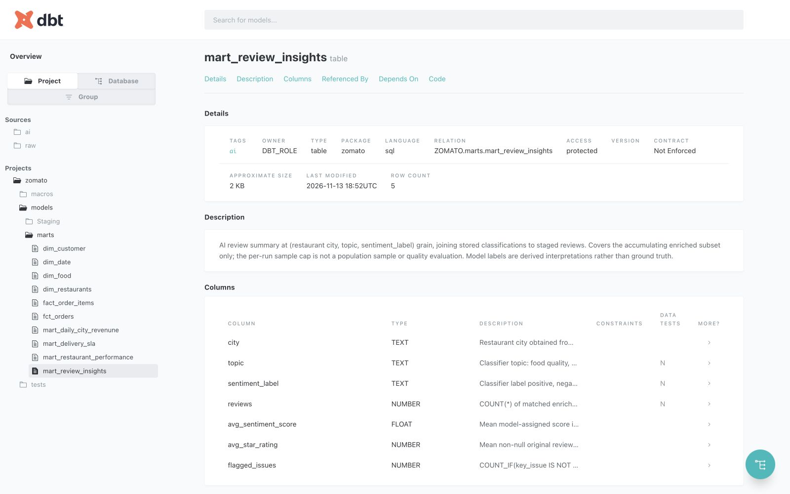
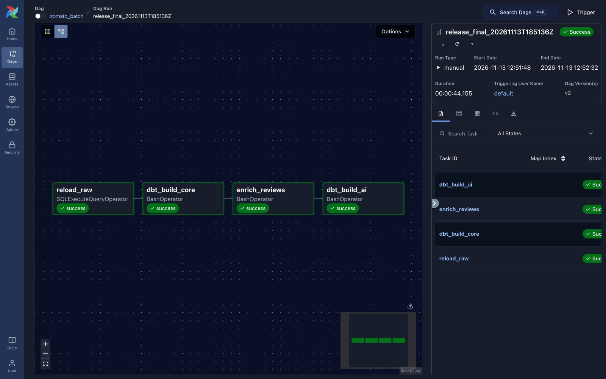
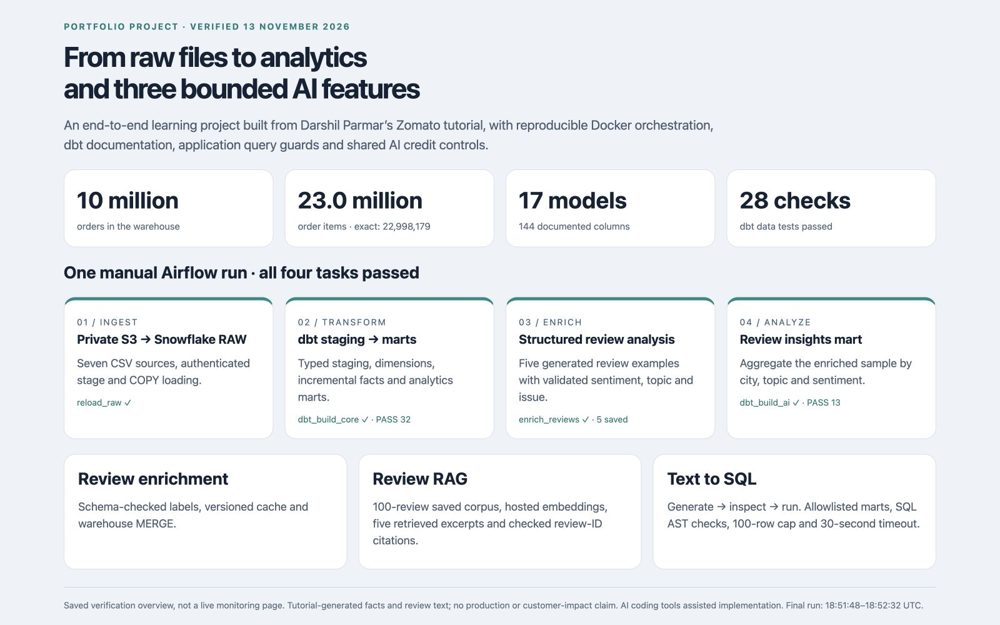
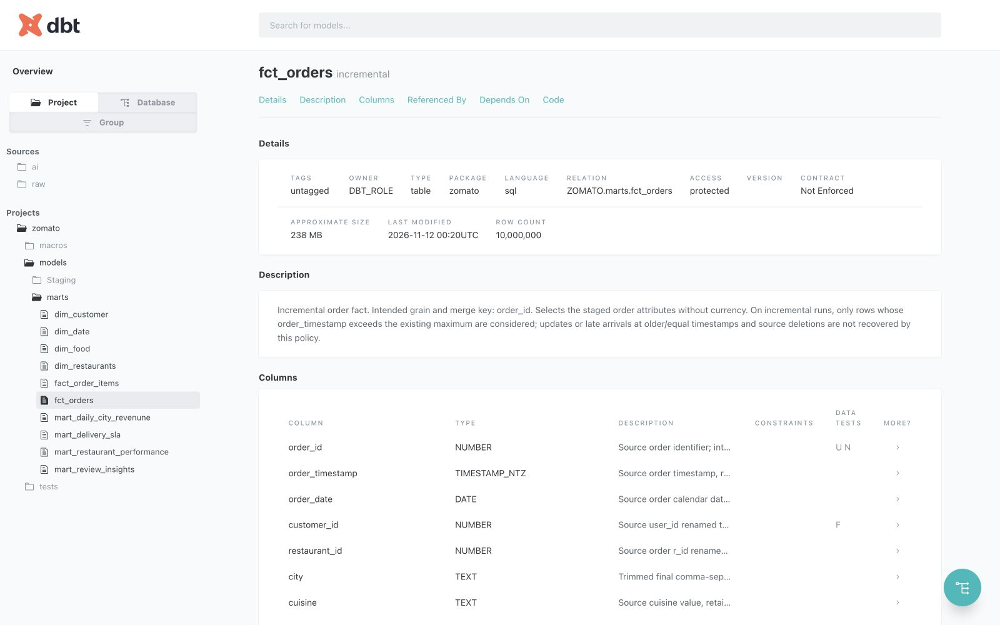
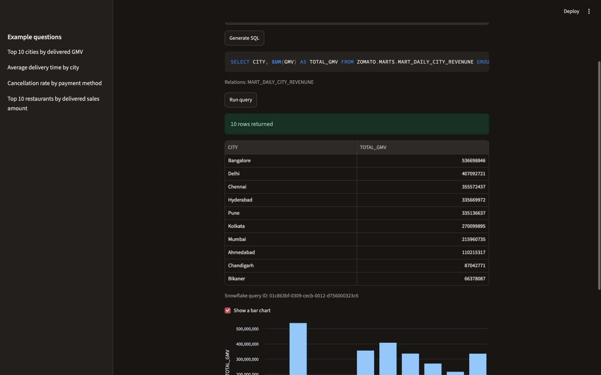

# Final project screenshot and example gallery

All15release captures are1600×1000JPEGs fromNovember13,2026. The [manifest](screenshots/manifest.json) includes individual captions and file hashes. The private working folder also retains7earlierPhase1captures; they are historical and are not mixed into this release gallery.

Start with the overview, finalAirflowrun, full dbtlineage, enrichment examples, RAGanswer and SQLresult for a six-image walkthrough. Use the individual feature sequences for a longer case study or carousel. No social post was published by this release.

## SQL: delivered GMV by city

Live Streamlit generation, reviewed SQL and ten Snowflake results. GMV is recorded delivered sales amount, not profit.

## RAG: food-quality question

Live app answer with five retrieved source excerpts and matching inline review-ID citations.

## RAG: price/value complaint

Live app answer cites review78; retrieved positive value comments remain visible for comparison.

## RAG: insufficient evidence

Live app declines a company-profit question that the review excerpts cannot answer.

## dbt: full release lineage

Generated dbt documentation after the successful final run, including the AI source, mart and tests.

## SQL: delivered-order duration

Live reviewed query computes order-grain AVG for delivered orders; ten highest-average cities returned. Captured before the later independent column-resolution guard.

## dbt: AI mart catalog

Generated catalog shows the five-row AI mart, its documented grain, limits and output columns.

## Airflow: four-task run passed

All four tasks green, final run success, manual trigger, first attempts. 44seconds is an existing-data replay, not a fresh-load benchmark.

## Project overview

Rendered summary of saved verification facts, explicitly labeled as a portfolio evidence view rather than a live dashboard.

## Enrichment: positive, negative and neutral

Rendered saved Snowflake outputs for three generated review texts. Labels and scores came from the successful final enrichment task.

## Enrichment: downstream review mart

Rendered saved Snowflake rows grouped by city/topic/sentiment; five reviews demonstrate the workflow only.

## Airflow: AI build/test log

Live Airflow log viewer shows1model,12passing data tests,PASS13 and exitcode0.

## dbt: order-fact catalog

Generated catalog for the10million-row order fact with authored descriptions and incremental-model context.

## SQL: cancellation by payment method

Live generation and execution after the final schema-resolution guard. Numerator counts Cancelled orders; denominator includes all orders. Five methods returned.

## SQL: result chart

Live chart of the same delivered-GMV result, rendered locally without another model call.

## Supporting data

- [Release summary](evidence/release_summary.json)
- [Saved warehouse examples and counts](evidence/warehouse_examples.json)
- [Accepted RAG examples](evidence/rag_examples.json)
- [Core dbt summary](evidence/dbt_build_core_summary.txt)
- [AI dbt summary](evidence/dbt_build_ai_summary.txt)

The overview and enrichment cards are rendered evidence pages generated by `build_showcase.py` from retained warehouse outputs. The Airflow, dbt and Streamlit screenshots show their actual interfaces. Tutorial-generated facts/review texts do not establish production traffic, real-customer research or model accuracy.
